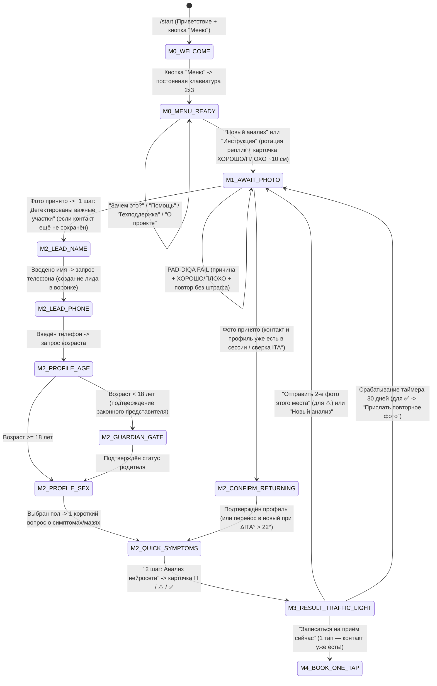

# Stage 7B · Фото-первый сценарий онбординга из Miro (Telegram-бот + Веб `/check`) и Конфигуратор каналов

Документ описывает утверждённый владельцем (Дима, 28.11.2026) сценарий коммуникации по доске Miro: лёгкий вход через меню 2×3 и наглядные визуальные примеры (`ХОРОШО ✅ / ПЛОХО ❌` ~10 см), отправка фото без предварительной анкеты, сбор `Имя + Телефон + Возраст/Пол` **сразу после загрузки фото на пике интереса**, 2 визуальных шага анализа и светофор `🔴 / ⚠️ / ✅` с таймером `30 дней` и проверкой `2-м фото`.

---

## 1. Диаграмма состояний фото-первого сценария (`Mermaid`)

---

## 2. Постоянное нижнее меню 2×3 (`ReplyKeyboard` Telegram)

| Кнопка 1-й колонки | Кнопка 2-й колонки | Назначение |
|---|---|---|
| `📷 Новый анализ` | `ℹ️ Инструкция` | Запуск фотопроверки с ротацией дружелюбных реплик и визуальными примерами `ХОРОШО ✅ / ПЛОХО ❌` (`~10 см`). |
| `💡 Зачем это?` | `🛠 Техподдержка` | Объяснение пользы регулярного фотоконтроля родинок и прямой канал связи по техническим вопросам. |
| `🆘 Помощь` | `📋 О проекте` | Напоминание о приоритете очного врача, дисклеймер безопасности и управление персональными данными (`152-ФЗ`). |

---

## 3. Уровни светофора и пост-механики удержания (строго без `%` и без диагнозов)

- **`🔴 Высокий уровень внимания` (`HIGH_URGENT`):** приоритетная очная консультация дерматолога с дерматоскопией; кнопки `Записаться на приём сейчас` и `Новый анализ`.
- **`⚠️ Средний уровень — плановая проверка врача` (`PLANNED_REVIEW` / `U5_MODIFIED_SKIN`):** рекомендация очного приёма + механика **«Удостоверься в результате»** (предложение сделать **2-е фото этого же места** чуть под другим углом для перепроверки устойчивости оценки).
- **`✅ Низкий уровень — спокойная визуальная картина` (`LOW_OBSERVATION`):** плановое наблюдение + автоматический **таймер напоминания на 30 дней** (`scheduled_followup_at = now() + 30 days`) с предложением прислать контрольное фото через месяц.
