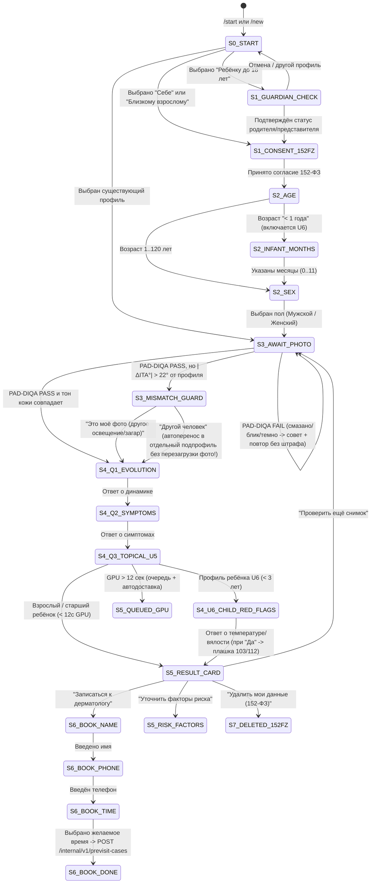

# Stage 7 · Архитектура диалога и ветвления Telegram-бота «Дерматолог Про» (первый тестовый канал)

Документ фиксирует этапы коммуникации, конечный автомат состояний (`FSM`), тексты сообщений (`patient_facing` по правилам `skindoctor-medical-claim-safety-agent`) и все ветвления диалога для Telegram-бота (`POST /api/v1/public/telegram/webhook` и интерактивный стенд проверки ветвлений `/bot-sim` + `/check`).

---

## 1. Ключевые продуктовые правила канала Telegram

1. **Квоты отключены (`QUOTA_ENFORCEMENT_ENABLED = false`):** пользователи и первые тестеры не блокируются лимитами `4/сутки, 10/мес`. Технический счётчик кадров ведётся пассивно, фоновая защита от автоматического скрейпинга конкурентами активна.
2. **Приём снимков «как удобно пользователю»:** бот принимает и сжатые фото из галереи/камеры (`message.photo`), и оригинальные файлы без сжатия (`message.document`), мягко подсказывая, что отправка «Файлом / Документом» сохраняет максимальную резкость и цветовой профиль `Display P3`.
3. **1 шаг = 1 задача = инлайн-кнопки:** никаких длинных анкет на входе. Фототип Фитцпатрика вручную не спрашивается (вычисляется сервером через угол `ITA°` по здоровой коже вокруг очага).
4. **Приватность в ленте чата:** в ответ пользователю возвращается карточка **только с локальными кропами очагов (`+25%` окружающей кожи)**, контуром, номером очага и шкалой качества кадра — без публикации полного лица или интимных зон в истории чата.

---

## 2. Схема состояний и ветвлений диалога (`Mermaid`)

---

## 3. Детальная таблица этапов, кнопок и ветвлений

| Состояние FSM | Сообщение бота (кратко) | Инлайн-кнопки (`callback_data`) / ввод | Условие перехода и защита |
|---|---|---|---|
| `S0_START` | Приветствие + пояснение, что сервис помогает подготовиться к очному осмотру дерматолога и не ставит диагноз. «Кому проверяем кожу?» | `rel:SELF` («Себе»), `rel:CHILD_UNDER_18` («Ребёнку до 18 лет»), `rel:ADULT_RELATIVE` («Близкому взрослому»), либо `prof:<id>` | Разделяет профили с первого тапа, чтобы не смешивать возраст, пол и `ITA°`. |
| `S1_GUARDIAN_CHECK` | Запрос подтверждения статуса родителя или законного представителя ребёнка. | `guard:confirm` («Подтверждаю статус законного представителя»), `nav:start` («Назад к выбору профиля») | Жёсткий гейт: без `guard:confirm` отправка фото ребёнка заблокирована. |
| `S1_CONSENT_152FZ` | Согласие на обработку данных (`152-ФЗ`, ст. 9, 10) и информационный характер маршрутизации. | `consent:accept` («Принимаю условия 152-ФЗ») | Фиксирует `consent_152fz_accepted_at` в профиле. |
| `S2_AGE` / `S2_INFANT_MONTHS` | Запрос возраста (быстрые кнопки или ввод числа; для `< 1 года` — месяцы `0..11`). | `age:infant` («До 1 года»), `age:5`, `age:12`, `age:28`, `age:45`, `age:65` или текст с числом | Для `< 3 лет` включает педиатрические правила `U6`. |
| `S2_SEX` | «Укажите биологический пол проверяемого человека:» | `sex:female` («Женский»), `sex:male` («Мужской») | Завершает Шаг 1 онбординга за ~15 сек без вопроса о фототипе. |
| `S3_AWAIT_PHOTO` | Памятка съёмки (дневной свет без вспышки, фокус 10–15 см, подсказка про «Файл / Документ»). | Приём `photo` или `document` | Сервер выполняет `Split-Vault` (`Display P3 -> sRGB`, удаление EXIF/GPS/Thumbnail) и `U2 PAD-DIQA`. При браке объясняет причину и ждёт новый кадр. |
| `S3_MISMATCH_GUARD` | Предупреждение о заметном отличии тона кожи (`\|ΔITA°\| > 22°`) от базового профиля. | `mm:same_person_lighting` («Это моё фото — другое освещение/загар»), `mm:switched_profile` («Проверяю другого человека») | Переносит уже загруженный кадр в отдельный подпрофиль без повторной отправки файла. |
| `S4_Q1_EVOLUTION` | Вопрос 1/3: «Как давно появилось образование и меняется ли оно?» | `q1:stable_long`, `q1:new_lt_3m`, `q1:growing_changing`, `q1:unsure` | Прицельный сбор динамики (`U3`). |
| `S4_Q2_SYMPTOMS` | Вопрос 2/3: «Беспокоит ли этот участок кожи?» | `q2:none`, `q2:itch_or_pain`, `q2:bleeding_or_crust` | Кровоточивость/корочка без травмы повышает приоритет до `HIGH_URGENT`. |
| `S4_Q3_TOPICAL_U5` | Вопрос 3/3: «Наносили ли что-то на участок за последние 14 дней?» | `q3:none`, `q3:steroid_ointment`, `q3:antiseptic_dye_celelandine`, `q3:moisturizer` | Гормоны/зелёнка/чистотел включают предупреждение `U5`, но **никогда не понижают** `HIGH_URGENT`. |
| `S4_U6_CHILD_RED_FLAGS` | (Только для малышей `U6`): «Есть ли у ребёнка температура, вялость или быстрое распространение высыпаний?» | `u6:no` («Нет, общее самочувствие обычное»), `u6:yes` («Да, есть общие симптомы») | При `u6:yes` выводит экстренный баннер вызова `103 / 112`. |
| `S5_RESULT_CARD` / `S5_QUEUED_GPU` | Приватная карточка локальных кропов (`+25%` кожи) + статус маршрута + 2–3 безопасных предложения (или спокойное уведомление об очереди `> 12 сек`). | `act:book_clinic` (**«Записаться к дерматологу»**), `act:risk_factors` («Факторы риска»), `act:new_photo` («Ещё снимок»), `act:delete_152fz` («Удалить мои данные») | Строгая проверка `assertPatientFacingCopySafe` и очистка сырых вероятностей/логитов. |
| `S6_BOOK_*` | Сбор имени, контактного телефона и удобного времени приёма (3 коротких реплики). | Текстовый ввод или быстрые слоты времени (`time:morning`, `time:evening`, `time:soonest`) | Создаёт заявку для `operator` (без фото и медтекста) и предвизитный кейс для `doctor` (`Status localis`). |
| `S7_DELETED_152FZ` | Подтверждение каскадного удаления пользовательских снимков и анкет по `152-ФЗ`. | `nav:start` («Начать заново») | Сохраняет неприкосновенность записей, уже вошедших в медкарту клиники по `323-ФЗ`. |
